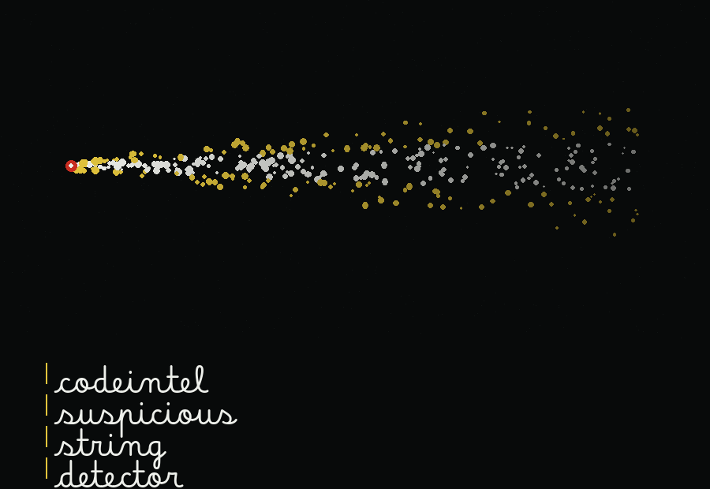
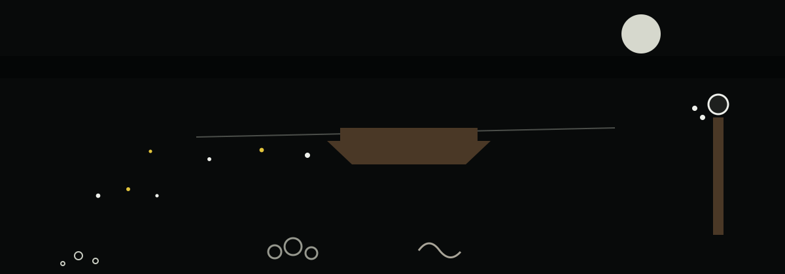

# codeintel-Suspicious-String-Detector

Title block: the name above is set in Betania Patmos In in ash white on a vent black plate ruled as a depth marker on a sounding line, with a ruled line beneath, a small shell at the left, and the single wake mark beside this first heading only. Headings after this stay typographic.

Scans code for potentially malicious or suspicious strings, such as those used in command injection or path traversal attacks. Flags strings based on regular expressions and entropy analysis. Focused on tools for static code analysis, vulnerability scanning, and code quality assurance.

## Install
`git clone https://github.com/ShadowGuard-AI/codeintel-suspicious-string-detector`

## Usage

> **Jetty notice: Entropy Is Measured on the Whole Line.** The entropy figure belongs to the whole stripped line, not to any one string inside it, and a line is measured only when the stripped line is longer than ten characters.

> **Jetty notice: A Pattern in a Comment Is Flagged as Text.** The search knows each line as text and nothing more, so a pattern inside a comment or a quoted example is flagged exactly as a pattern in live code would be.
`python3 main.py (-f FILE | -d DIRECTORY) [-e ENTROPY_THRESHOLD] [-l LOG_FILE]`

## Parameters

> **Jetty notice: the comparison is strict.** A line is flagged for entropy only when the entropy of the whole stripped line is strictly greater than the threshold; a line at the threshold itself is not flagged. A log path which cannot be opened ends the run with an error and exit 1 before scanning starts.
- `-h`: Show help message and exit
- `-f`, `--file`: Path to the file to scan. Exactly one of `-f` and `-d` is required.
- `-d`, `--directory`: Path to the directory to scan (recursively).
- `-e`, `--entropy_threshold`: Entropy threshold for detecting high-entropy strings (default: 4.5).
- `-l`, `--log_file`: Path to the log file. If not provided, logs will be printed to the console.

## Verified behavior
- A file containing a high-entropy string (entropy 4.57 in the test) and an `os.system` call is flagged for both, and the run exits 0.

> **Jetty notice: A Finding Is Not an Error.** Findings are reported in the output and the run still exits 0; the exit code tracks read errors alone, with a missing file, an unreadable file, or a directory that is not a directory each returning or exiting 1.

## License
See LICENSE.
